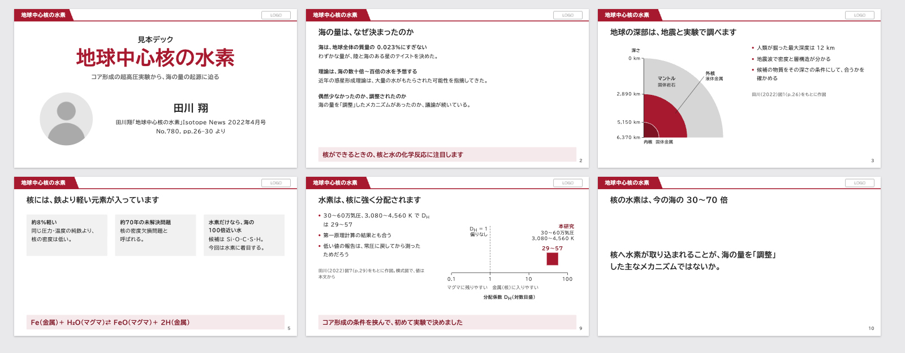
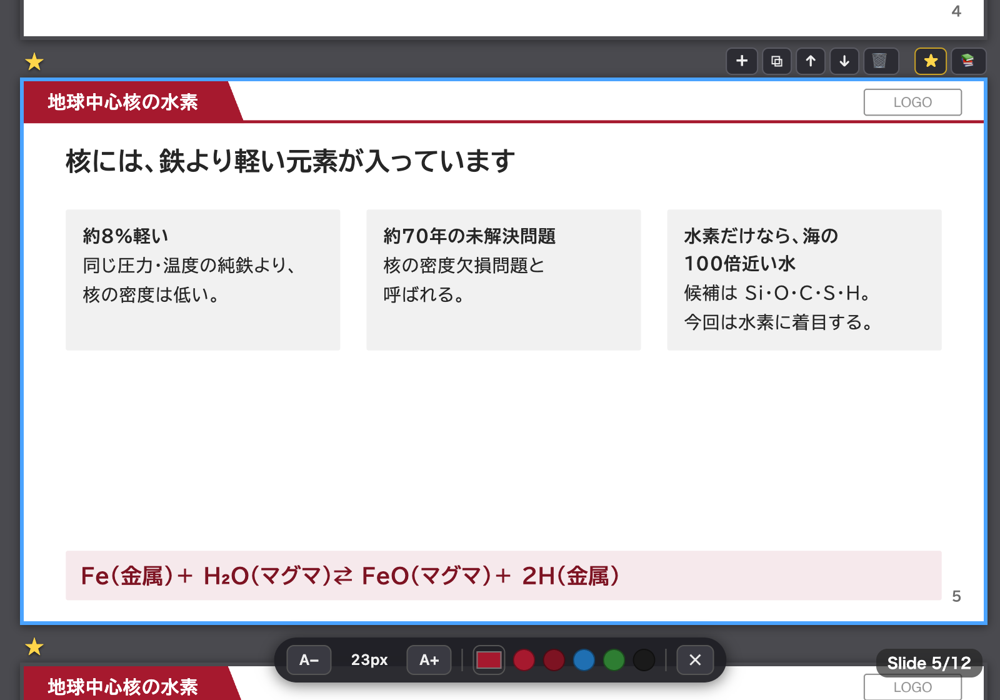
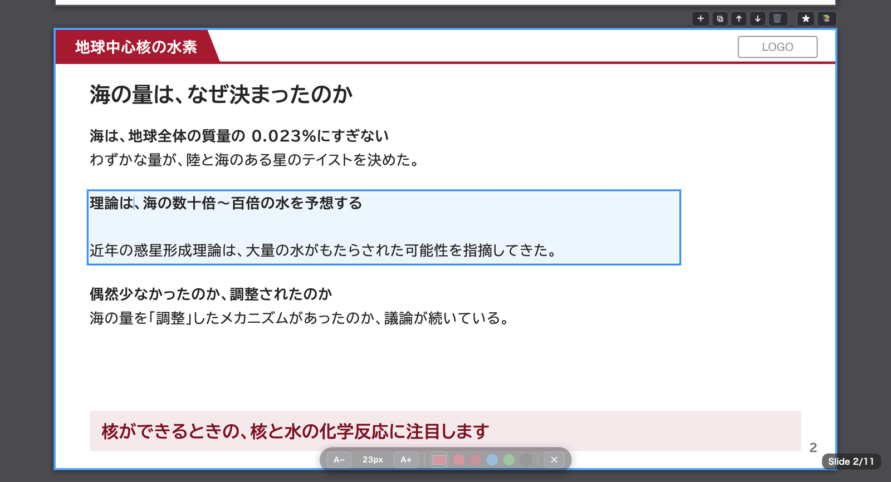
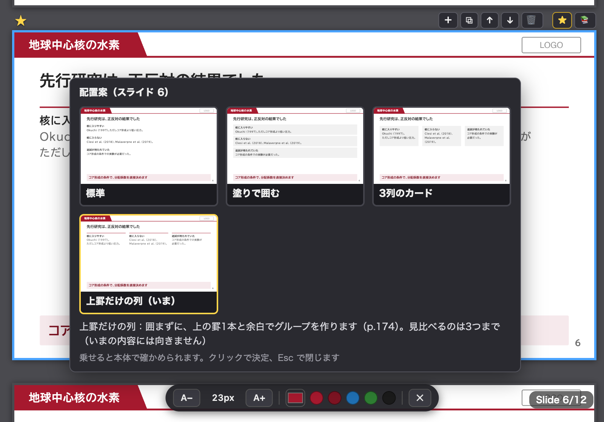
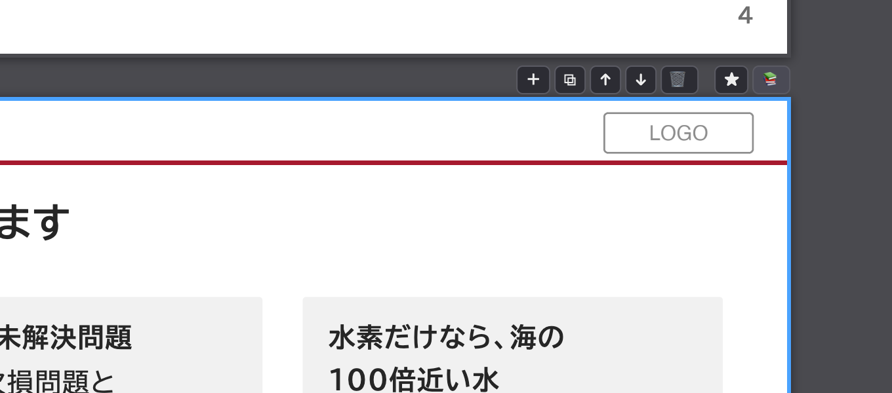
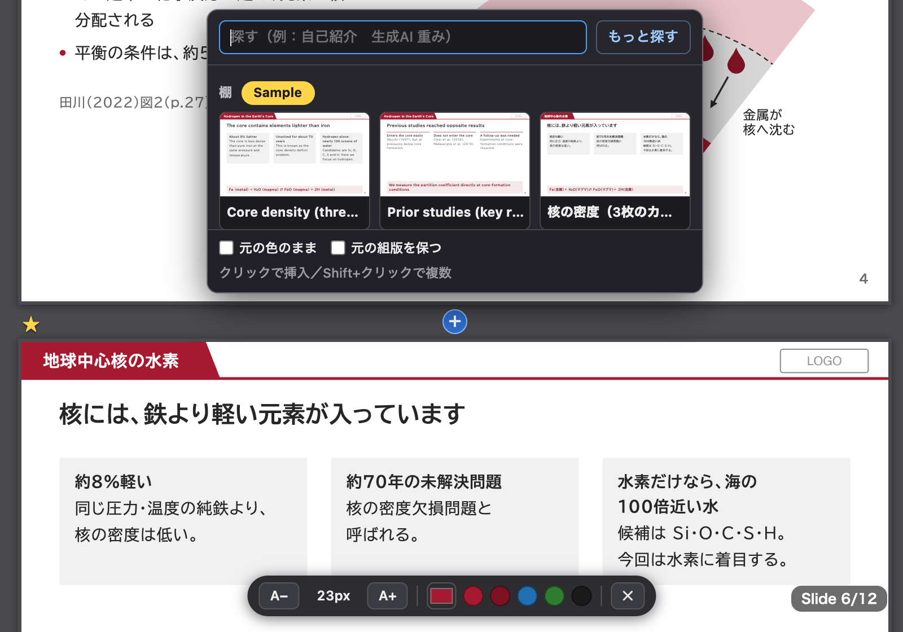
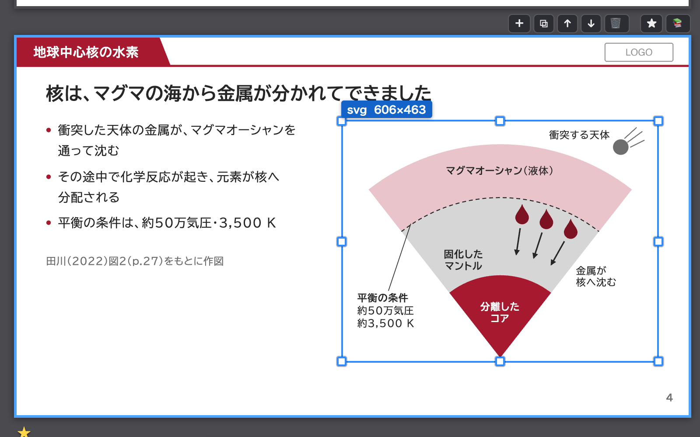

# marp-GUI

**日本語** | [English](README.en.md)

Marp のスライドを、**VS Code のプレビュー上でさわって作る**ための環境です。
原稿はふつうの Markdown のまま。プレビューで文字をダブルクリックして直したり、右クリックで配置を選んだり、スライドを並べ替えたりできます。

- 同期プレビュー：原稿のカーソル位置のスライドを横に表示（クリックで原稿の該当行へ）
- プレビューで直接編集：文字をダブルクリック → Enter で原稿に書き戻す
- 配置案：スライドを右クリック → 3列カード・図と文の2カラムなどを見比べて1クリックで切り替え
- スライド操作：追加・複製・並べ替え・削除、既存スライドの検索と挿入
- 📄 PDF（ベクター・文字がにじまない）と ▶ プレゼン（Chrome で全画面）
- テーマ `tsutawaru-academic`：『伝わるデザインの基本』のルールに沿った、囲みの少ない学術スライド

mac / Windows で使えます。

> **ご注意**：このソフトウェアは無償で「現状のまま（AS IS）」提供しており、いかなる保証もありません。法律が認める最大限の範囲で、使用によって生じた損害について、作者および貢献者は責任を負いません。詳しくは下の「[免責事項](#免責事項)」をご覧ください。

## できること



このような学術スライドを、ふつうの Markdown から作れます。上は見本デック「地球中心核の水素」の一部です。



VS Code の右側に開く同期プレビューです。原稿（左側）のカーソルを動かすと、プレビューもそのスライドへ移り、青い枠で示します。上にスライド操作のボタン、下に文字の大きさと色のバーが出ます。

---

## 1. 必要なもの（先に入れておく）

| もの | 入手先 |
|---|---|
| **VS Code** | https://code.visualstudio.com/ |
| **Node.js**（LTS 版） | https://nodejs.org/ja/download |
| **Google Chrome**（または Edge） | PDF とプレゼンに使います |

## 2. ダウンロード

このページ上の緑の **「Code」ボタン → 「Download ZIP」** を押し、ZIP を展開します。
展開したフォルダ（`marp-GUI-main`）は、**書類フォルダなど、ずっと置いておく場所**へ移してください（ダウンロードフォルダのままだと、消したときに使えなくなります）。

git が使える方は：

```bash
git clone https://github.com/ShohTagawa/marp-GUI.git
```

## 3. インストール（ダブルクリック1回）

| mac | Windows |
|---|---|
| `install-mac.command` を **右クリック →「開く」**（初回だけ。確認が出たら「開く」） | `install-windows.bat` を **ダブルクリック**（「PC を保護しました」と出たら「詳細情報」→「実行」） |

黒い画面で必要な部品が入り（初回は数分）、最後に VS Code が見本のスライドを開きます。
VS Code が先に開いていた場合は、コマンドパレット（⌘⇧P / Ctrl+Shift+P）で **「Developer: Reload Window」** を実行してください。

ターミナルに慣れている方は、フォルダで次の1行でも同じです。

```bash
npm run setup
```

> フォルダを別の場所へ動かしたら、もう一度インストーラーを実行してください（VS Code への登録を貼り直します）。

## 4. 使ってみる

1. VS Code で **フォルダ `marp-GUI` を開いた状態**にする（「ファイル」→「フォルダーを開く」）
2. `slides/sample-layouts/sample-layouts.md` を開く
3. **⌘K M**（Windows は **Ctrl+K M**）で、右に同期プレビューが開きます

| やりたいこと | 操作 |
|---|---|
| ホームを開く（最近・棚・手を入れた順・検索） | **⌘K H**（Windows は **Ctrl+K H**）、または右下の **🏠 Marp** |
| 文字を直す | プレビューの文字を **ダブルクリック** → 打つ → **Enter**（Esc で取り消し） |
| 配置を変える | プレビューのスライドを **右クリック** → 案を選ぶ |
| スライドを足す・複製・移動・削除 | スライド右上のボタン（＋ ⧉ ↑ ↓ 🗑） |
| スライドの間に既存スライドを入れる | スライドの間にマウスを乗せて出る **＋** |
| 箱を動かす・大きさを変える | **Alt（mac は Option）＋クリック** → ドラッグ |
| PDF にする | 画面下のステータスバーの **📄 PDF**（`out/` フォルダに出ます） |
| 発表する | ステータスバーの **▶ プレゼン**（F=全画面 / P=発表者ビュー / ←→=ページ送り） |
| 元に戻す | ⌘Z / Ctrl+Z |

### 文字を直す



プレビューの文字をダブルクリックすると、その場で打ち直せます。Enter で確定すると、原稿の該当箇所だけが書き換わります。

### 配置を変える



スライドを右クリックすると、同じ原稿のまま並び方を変えた案がサムネイルで並びます。選ぶと原稿の1行（`_class`）だけが変わります。

### スライドを足す・複製・移動・削除



プレビューで選んだスライドの右上にボタンが出ます。新しいスライドの追加、複製、前後への移動、削除ができます。

### 既存のスライドを入れる



スライドの間にマウスを乗せると ＋ が出ます。押すと、ほかのデックのスライドを検索して、その位置に入れられます。

### 箱を動かす・大きさを変える



Alt（mac は Option）を押しながらクリックすると、箱に枠が出ます。ドラッグで移動し、角のハンドルで大きさを変えられます。

操作の一覧と細かい設定は [tools/marp-scroll-sync/README.md](tools/marp-scroll-sync/README.md) にあります。

## 5. 自分のスライドを作る

見本のフォルダをまるごと複製して、名前を変えるのがいちばん簡単です。

```
slides/
  my-talk/            ← フォルダ名と
    my-talk.md        ← md の名前をそろえる
    src/              ← 画像はここに入れ、md からは ./src/fig01-xxx.png で参照
    out/              ← PDF などはここに出ます
  assets/             ← ロゴなど、複数のデックで共有する画像
```

- ファイル名は **半角英数とハイフン** だけにしてください（全角・空白はリンク切れの原因になります）
- ロゴは `slides/assets/logo-placeholder.png` を差し替えるか、md 先頭の `header:` の画像を書き換えます
- 表紙の写真は `slides/assets/profile-placeholder.png` を差し替えます

### 原稿の書き方（最小）

```markdown
---
marp: true
theme: tsutawaru-academic
paginate: true
header: '<div class="hdr-left">発表タイトル</div>'
---

<!-- _class: lay-cards3 -->

## 見出し

- **1つめ**
  説明
- **2つめ**
  説明
- **3つめ**
  説明

<div class="takeaway">この1枚で言いたいこと</div>
```

- スライドの区切りは `---`（前後に空行）
- `<!-- _class: lay-cards3 -->` のような **配置クラス**を1語足すだけで並び方が変わります（右クリックの配置案が、これを書き換えます）。
  使える配置は `sample-layouts.md`、部品は `sample-parts.md` を見てください
- 下端の要点帯は `<div class="takeaway">…</div>`

## 6. うまく行かないとき

| 症状 | 対処 |
|---|---|
| ⌘K M でプレビューが出ない／ボタンが無い | インストーラーをもう一度実行 → VS Code で「Developer: Reload Window」 |
| 📄 / ▶ が出ない | md の先頭に `marp: true` があるか。VS Code で **marp-GUI フォルダ** を開いているか |
| PDF が「Printing failed」で止まる | ターミナルで `npm run pdf:safe -- slides/<デック>/<デック>.md`（分割を細かくします） |
| 「Node.js が見つかりません」 | Node.js を入れたあと、VS Code とインストーラーを開き直す |
| 状態を確かめたい | `npm run setup:check` |

## 7. ターミナルから使う（任意）

```bash
npm run pdf      -- slides/<デック>/<デック>.md   # ベクターPDF（引数なし＝最後に編集したデック）
npm run present  -- slides/<デック>/<デック>.md   # Chrome で全画面プレゼン
npm run png      -- slides/<デック>/<デック>.md   # 全ページを PNG に
npm run lint     -- slides/<デック>               # 囲み過多・文字過多などの点検
```

## 中身

```
theme/            academic.css（土台）と tsutawaru-academic.css（推奨テーマ）
slides/           見本デック 2 本（sample-layouts / sample-parts）と共有画像
tools/
  marp-scroll-sync/   VS Code 拡張：同期プレビュー・直接編集・配置案・スライド操作
  marp-pdf/           ベクターPDF（分割印刷→結合）と、📄/▶ ボタンの VS Code 拡張
  marp-present/       Chrome で全画面プレゼン
  marp-library.mjs    既存スライドの検索・挿入（プレビューの ＋ から使われる）
  setup.mjs           セットアップ本体（インストーラーが呼ぶ）
install-mac.command / install-windows.bat
```

VS Code 拡張はマーケットプレイスを通さず、このフォルダを `~/.vscode/extensions/` に登録（リンク）して使います。外すときは `~/.vscode/extensions/marp-gui.scroll-sync` と `marp-gui.pdf` を削除してください（リンクなので、本体は消えません）。

## ご寄付のお願い

このツールは、限られた予算の中で開発しています。役に立ったと感じていただけたら、千葉大学基金へのご寄付をご検討いただけるとうれしいです。ご寄付は千葉大学の教育・研究を支えるもので、このソフトウェアの開発に使途を指定するものではありません。

- 千葉大学基金：https://kikin.chiba-u.ac.jp/
- ご寄付の方法：https://kikin.chiba-u.ac.jp/howto

## ライセンス

Apache License 2.0（[LICENSE](LICENSE)）。テーマ・拡張・ツールとも自由に使い、改変できます。

## 免責事項

以下は Apache License 2.0 の第7条（保証の否認）と第8条（責任の制限）の内容を、確認のために補足して記したものです。ライセンスの条件を変更・追加するものではありません。内容が食い違う場合は、[LICENSE](LICENSE) が優先します。

- このソフトウェアは無償で「現状のまま（AS IS）」提供しており、明示・黙示を問わず、商品性、特定目的への適合性、権利を侵害していないことを含め、いかなる保証もありません。
- 適用される法律が認める最大限の範囲で、作者および貢献者は、このソフトウェアの使用または使用できなかったことから生じた損害（データの消失、スライドや原稿の破損、業務の中断、その他の直接・間接・付随的・結果的な損害を含みます）について、一切の責任を負いません。
- 法律上どうしても責任を免れることができない場合でも、その責任は、利用者がこのソフトウェアに支払った金額（無償のため 0 円）を上限とします。
- このソフトウェアは原稿ファイルを直接書き換えます。大切な原稿は、ご自身でバックアップを取ってからお使いください。
- Marp は原稿中の HTML をそのまま描画します。出どころのわからない、または信頼できないデック（.md ファイル）を開くときは、中身を確かめてからにしてください。どのファイルを開くかは、利用者ご自身の責任で判断してください。
- このソフトウェアは AI 駆動開発で作成しており、AI を使ってセキュリティの確認を行っていますが、安全性について作者は保証できません。
