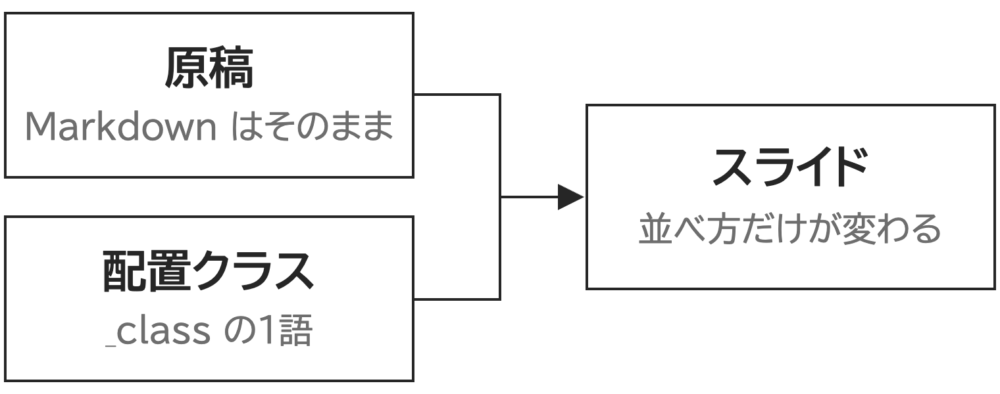

<!-- _class: cover-hero -->

tsutawaru-academic

配置クラスの見本

同じ原稿を、_class の1語で並べ替えます

氏名

所属

---

3項目／標準

## 配置クラスは、3つの場面で役に立ちます

- **原稿を書くとき**
  箇条書きのまま書き進められます。
- **並べ方を選ぶとき**
  _class の1語を替えるだけで済みます。
- **仕上がりを確かめるとき**
  はみ出す案には印が付きます。

配置クラスなしでは、見出し＋説明の箇条書きです

---

<!-- _class: lay-boxed -->

3項目／lay-boxed

## 配置クラスは、3つの場面で役に立ちます

- **原稿を書くとき**
  箇条書きのまま書き進められます。
- **並べ方を選ぶとき**
  _class の1語を替えるだけで済みます。
- **仕上がりを確かめるとき**
  はみ出す案には印が付きます。

目標・ねらいの1枚に使います

---

<!-- _class: lay-cards3 -->

3項目／lay-cards3

## 配置クラスは、3つの場面で役に立ちます

- **原稿を書くとき**
  箇条書きのまま書き進められます。
- **並べ方を選ぶとき**
  _class の1語を替えるだけで済みます。
- **仕上がりを確かめるとき**
  はみ出す案には印が付きます。

3つを同じ重さで並べます

---

<!-- _class: lay-keyrow -->

3項目／lay-keyrow

## 配置クラスは、3つの場面で役に立ちます

- **原稿を書くとき**
  箇条書きのまま書き進められます。
- **並べ方を選ぶとき**
  _class の1語を替えるだけで済みます。
- **仕上がりを確かめるとき**
  はみ出す案には印が付きます。

囲まずに、上の罫1本で並べます

---

4項目／標準

## 配置を選ぶ前に、4つの点を確かめます

- **項目の数**
  横に並べるのは3つまでにします。
- **順序の有無**
  順序があれば、流れか手順にします。
- **図の有無**
  図があれば、文と左右に分けます。
- **文の長さ**
  長い説明は、カードに入れません。

---

<!-- _class: lay-cards2 -->

4項目／lay-cards2

## 配置を選ぶ前に、4つの点を確かめます

- **項目の数**
  横に並べるのは3つまでにします。
- **順序の有無**
  順序があれば、流れか手順にします。
- **図の有無**
  図があれば、文と左右に分けます。
- **文の長さ**
  長い説明は、カードに入れません。

4つは 2×2 に分けます

---

手順／標準

## 配置案は、3つの手順で選べます

1. **スライドを右クリックします**
   配置案が小さな絵で並びます。
2. **案にマウスを乗せます**
   その場で大きく確かめられます。
3. **クリックして決めます**
   原稿の _class だけが変わります。

番号つきの箇条書きが標準です

---

<!-- _class: lay-flow -->

手順／lay-flow

## 配置案は、3つの手順で選べます

1. **スライドを右クリックします**
   配置案が小さな絵で並びます。
2. **案にマウスを乗せます**
   その場で大きく確かめられます。
3. **クリックして決めます**
   原稿の _class だけが変わります。

左から右へ、一方向に流します

---

<!-- _class: lay-steps -->

手順／lay-steps

## 配置案は、3つの手順で選べます

1. **スライドを右クリックします**
   配置案が小さな絵で並びます。
2. **案にマウスを乗せます**
   その場で大きく確かめられます。
3. **クリックして決めます**
   原稿の _class だけが変わります。

上から下へ、番号で順序を示します

---

図つき／標準

## 原稿はそのままで、並べ方だけが変わります

- 原稿は素の Markdown で書きます
- 配置クラスは _class に1語だけ足します
- 図と文の位置はテーマが決めます

---

<!-- _class: lay-fig-right -->

図つき／lay-fig-right

## 原稿はそのままで、並べ方だけが変わります

- 原稿は素の Markdown で書きます
- 配置クラスは _class に1語だけ足します
- 図と文の位置はテーマが決めます

文を左、図を右に置きます

---

<!-- _class: lay-fig-left -->

図つき／lay-fig-left

## 原稿はそのままで、並べ方だけが変わります

- 原稿は素の Markdown で書きます
- 配置クラスは _class に1語だけ足します
- 図と文の位置はテーマが決めます

図を左、文を右に置きます

---

<!-- _class: lay-fig-top -->

図つき／lay-fig-top

## 原稿はそのままで、並べ方だけが変わります

- 原稿は素の Markdown で書きます
- 配置クラスは _class に1語だけ足します
- 図と文の位置はテーマが決めます

図を上に大きく置きます

---

<!-- _class: lay-fig-right -->

svg／lay-fig-right

## 見出しと要点の帯は、どの配置でも動きません

<svg viewBox="0 0 520 300" xmlns="http://www.w3.org/2000/svg" role="img" aria-label="見出しと本文と要点の位置"><rect x="2" y="2" width="516" height="296" fill="#fff" stroke="var(--rule, #D6D6D6)" stroke-width="2"/><rect x="2" y="2" width="516" height="34" fill="var(--accent, #A6192E)"/><rect x="40" y="62" width="300" height="22" fill="var(--ink, #262626)"/><rect x="40" y="110" width="200" height="100" fill="var(--fill, #F1F1F1)"/><rect x="262" y="110" width="216" height="100" fill="var(--fill, #F1F1F1)"/><rect x="40" y="238" width="438" height="36" fill="var(--accent-soft, #F6E9EC)"/><text x="140" y="168" font-size="22" text-anchor="middle" fill="var(--ink, #262626)">文</text><text x="370" y="168" font-size="22" text-anchor="middle" fill="var(--ink, #262626)">図</text><text x="259" y="263" font-size="20" text-anchor="middle" fill="var(--accent-dark, #7D1322)">要点の帯は動きません</text></svg>

- 見出しはヘッダーのすぐ下に置きます
- 本文だけが配置クラスで並び替わります

インライン svg も図として扱います

---

<!-- _class: lay-fig-left -->

svg／lay-fig-left

## 見出しと要点の帯は、どの配置でも動きません

<svg viewBox="0 0 520 300" xmlns="http://www.w3.org/2000/svg" role="img" aria-label="見出しと本文と要点の位置"><rect x="2" y="2" width="516" height="296" fill="#fff" stroke="var(--rule, #D6D6D6)" stroke-width="2"/><rect x="2" y="2" width="516" height="34" fill="var(--accent, #A6192E)"/><rect x="40" y="62" width="300" height="22" fill="var(--ink, #262626)"/><rect x="40" y="110" width="200" height="100" fill="var(--fill, #F1F1F1)"/><rect x="262" y="110" width="216" height="100" fill="var(--fill, #F1F1F1)"/><rect x="40" y="238" width="438" height="36" fill="var(--accent-soft, #F6E9EC)"/><text x="140" y="168" font-size="22" text-anchor="middle" fill="var(--ink, #262626)">文</text><text x="370" y="168" font-size="22" text-anchor="middle" fill="var(--ink, #262626)">図</text><text x="259" y="263" font-size="20" text-anchor="middle" fill="var(--accent-dark, #7D1322)">要点の帯は動きません</text></svg>

- 見出しはヘッダーのすぐ下に置きます
- 本文だけが配置クラスで並び替わります

---

<!-- _class: lay-lead -->

1文／lay-lead

## この見本で伝えたいこと

原稿を書き換えずに、並べ方だけを試せます。

---

<!-- _class: lay-points -->

要点だけ／lay-points

## この見本で伝えたいこと

- 原稿は素の Markdown で書きます
- 配置は _class の1語で決めます
- 横に並べるのは **3つまで** にします
- 図があれば文と左右に分けます
- はみ出す案には印が付きます

1行1要点・5行まで。文字をとても少なくした1枚です

---

<!-- _class: lay-points -->

要点だけ／見出しなし

- 原稿は素の Markdown で書きます
- 配置は _class の1語で決めます
- 横に並べるのは **3つまで** にします
- 図があれば文と左右に分けます
- はみ出す案には印が付きます

---

<!-- _class: lay-fig-only -->

図だけ／lay-fig-only

図だけを大きく見せて、要点の帯で締めます

